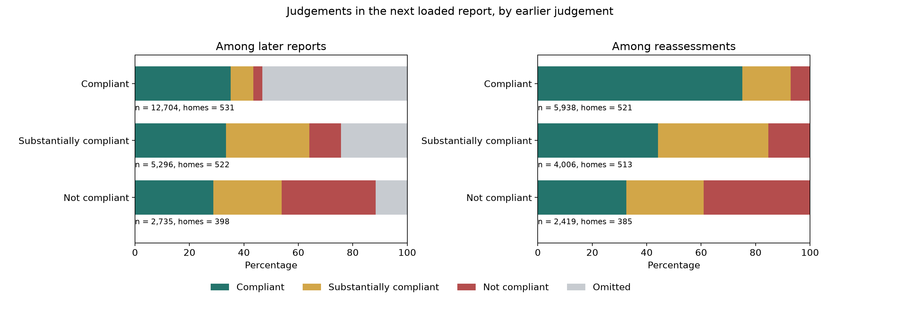

# Nursing home inspection follow up in Ireland

## Executive summary

This study addresses the original question, “Can we predict regulation failures?”, by first establishing what the available inspection history can support. It measures how often a regulation appears in a home's next loaded report and how the next recorded judgement varies with the earlier judgement. Predictive performance has not been measured. The completed analysis provides descriptive evidence and an assessment of modelling feasibility.

The frozen ClearCare export contains 2,019 reports from 535 homes. Among 27,473 starting regulation judgements, 20,735 have a later eligible report. The same regulation is reassessed in 12,363 of those observations, or 59.6%. Among reassessments, 1,982 later judgements are Not compliant, or 16.0%.

Reassessment occurs after 46.7% of earlier Compliant judgements, 75.6% of Substantially compliant judgements and 88.4% of Not compliant judgements with follow-up. Among the reassessed observations, the respective later Not compliant proportions are 7.1%, 15.4% and 39.1%. These unadjusted differences show that earlier judgement is associated both with being observed again and with the next recorded result.

Source checks cover 12 deliberately selected PDFs from six homes. All 155 unique exported judgements checked matched the reports, while four additional printed registration judgements were missing from the export. The sample supports bounded document-level checks and does not estimate national extraction accuracy. The most immediate website use is a clear, sourced account of inspection history and reassessment coverage.

## Research purpose and question

ClearCare presents HIQA findings to families comparing nursing homes. A single finding is easier to understand when users can see whether inspectors assessed the same regulation again and what they recorded. The original prediction question requires a reliable historical dataset before a model can be evaluated.

The operational research question is therefore how an earlier judgement relates to reassessment and the subsequent recorded judgement at the next eligible loaded report. The study also asks whether the available number of observations justifies investigating a future pooled prediction model. “Not compliant” is retained as the outcome label because it is the recorded judgement. An observation concerns one regulation at one home and does not represent a general judgement about the home's present safety.

The work builds on ClearCare's existing national re-assessment view. Its contribution is the reproducible denominator analysis, the breakdown by regulation and earlier judgement, the additional source checks, and the explicit treatment of observation and prediction limitations. [1, 2]

## Data sources and observation window

The report inventory was preserved from the 9 November listing associated with the 8 November register of 547 homes. Report details and the view-backed national matrix were retrieved on 17 November. The snapshot includes 2,019 loaded reports from 535 homes, with latest loaded inspection date 19 August 2026. A total of 531 homes have at least two reports. This is the loaded research population, with coverage dependent on ingestion and report availability. [1, 3]

The archive contains the centre listings, individual report responses, statistics matrix and a manifest of file checksums. A separate checksum verifies the ZIP archive. Exact original per-response retrieval timestamps were not captured. Preservation times and cache modification times remain documented, with no assumption that they equal API retrieval times.

The API records inspection dates, regulation identifiers and judgements. Publication dates are absent from this saved report schema. Thus the order of inspections can be reconstructed, while the time at which each result became publicly available cannot be established from this export alone. Source checks were expanded on 18 November using the original HIQA PDFs linked in the audit records. [3, 4]

## Definitions and pairing rules

| Term | Meaning in this study |
|---|---|
| Starting observation | One distinct regulation judgement in one loaded report |
| Follow-up | The same home's next loaded report with a strictly later inspection date |
| Reassessed | The same regulation identifier appears in the paired report |
| Omitted | A follow-up exists, but that report does not list the regulation |
| No later report | No eligible later loaded report exists by the dataset freeze |
| Later judgement | Compliant, Substantially compliant or Not compliant in the paired report |

Pairing stops at the first later loaded report. It does not skip a report that omits the regulation in order to find an eventual reassessment. Reports that were never loaded can be passed over, so the next loaded report may differ from the next inspection actually conducted. This definition follows ADR-0015 and must remain explicit in reporting. [1]

The general pairing rule excludes undated reports and starting observations whose next date has multiple candidate reports. The frozen snapshot had no undated reports and no same-date report groups. Consequently, those potential exclusions removed no observations in this dataset.

Repeated occurrences of a regulation identifier within a report use the first exported judgement to match the existing view. Seventeen duplicate raw occurrences were removed in the snapshot, all documented in the Claremount example. The first-occurrence rule is a reproducibility rule and cannot, by itself, verify that the first entry is correct. Source checks address that separately.

## Analysis methods

The analysis groups observations by earlier judgement, by regulation, and by both together. Each table includes counts of starting observations with and without later reports, reassessments and subsequent judgement classes. Distinct-home counts describe how widely each result is distributed. A home may appear in multiple rows, and a report pair may contribute several regulations. The distinct-home counts therefore cannot be added across rows to obtain a count of unique homes.

Reassessment percentage is the number reassessed divided by the number with an eligible later report. Later non-compliance percentage is the number of later Not compliant judgements divided by the number reassessed. A third quantity, recorded non-compliance across all follow-ups, uses all follow-ups as its denominator. These quantities answer different questions. Omitted regulations have unknown outcomes.

All three exported tables are reconciled with the saved national matrix. The build verifies archive and per-file hashes, unique report IDs, inventory counts, centre/date alignment and all 15 earlier-by-next-result cells. The analysis reports exact descriptive percentages for this frozen cohort. It does not calculate population confidence intervals, adjust for repeated observations or fit a predictive model.

## National follow up results

| Stage | Count |
|---|---:|
| Loaded reports | 2,019 |
| Starting reports with a later paired report | 1,484 |
| Starting regulation judgements | 27,473 |
| Starting judgements with a later report | 20,735 |
| Starting judgements without a later loaded report | 6,738 |
| Reassessed regulations among follow-ups | 12,363 |
| Regulations omitted from the paired report | 8,372 |
| Later Compliant judgements | 7,019 |
| Later Substantially compliant judgements | 3,362 |
| Later Not compliant judgements | 1,982 |

Among follow-ups, 59.6% were reassessed and 40.4% were omitted. Among reassessments, 56.8% were Compliant, 27.2% Substantially compliant and 16.0% Not compliant. The recorded Not compliant fraction across all follow-ups was 9.6%. The difference between 16.0% and 9.6% results from the denominator and leaves the omitted observations unresolved. [3]

## Earlier judgement and subsequent findings

| Earlier judgement | Follow-ups | Reassessed | Reassessment rate | Later Not compliant | NC among reassessed |
|---|---:|---:|---:|---:|---:|
| Compliant | 12,704 | 5,938 | 46.7% | 422 | 7.1% |
| Substantially compliant | 5,296 | 4,006 | 75.6% | 615 | 15.4% |
| Not compliant | 2,735 | 2,419 | 88.4% | 945 | 39.1% |

The earlier Not compliant group was reassessed in 385 distinct homes, and its 945 later Not compliant observations occurred in 216 homes. For the earlier Compliant group, 5,938 reassessments occurred in 521 homes and 422 later Not compliant observations in 207 homes. The corresponding figures for Substantially compliant were 4,006 reassessments in 513 homes and 615 later Not compliant observations in 249 homes. These repeated observations should not be treated as independent events in an inferential model.

Of the 2,419 reassessed observations that began Not compliant, 787 were subsequently Compliant and 687 Substantially compliant. Those two categories together account for 60.9% of reassessments in that group. This describes the next recorded judgement and does not prove that an intervention caused improvement or that it was sustained.



Figure 1. The left panel includes omitted regulations among observations with follow-up. The right panel conditions on reassessment. Home counts overlap between categories. All findings refer to the next loaded eligible report.

## Differences between regulations

The dataset contains 32 exported regulation identifiers. Reassessment frequency varies markedly. Regulation 23 was reassessed in 1,465 of 1,469 follow-ups, while Regulation 22 was reassessed in 21 of 315. Regulation 32 had 30 follow-ups and no reassessments. Its subsequent compliance distribution is undefined.

Regulation 23 contributed 513 later Not compliant judgements among 1,465 reassessments. Regulation 17 contributed 208 among 960, and Regulation 28 contributed 173 among 491. These counts combine the frequency of reassessment, the earlier findings and the regulation-specific outcome distribution. They should not be used alone to rank regulatory performance.

The complete counts are supplied in the regulation appendix. The separate by-regulation-and-earlier-judgment table supports comparisons within a regulation. The pooled headline percentages remain unadjusted for differing regulation mixes, centre characteristics and inspection selection. [3]

## Source checks and observed omissions

The first source check examined adjacent report pairs from Aclare House and The Marlay. The additional check deliberately selected Claremount for a duplicate-entry example, TLC Carton for a focused and a broader inspection, Clonskeagh for a community nursing unit, and Bishopscourt for reports from 2023 and 2026. Bishopscourt's selected reports were not adjacent. These choices broadened the examples without forming a representative sample.

For each checked report, Appendix 1 entries were compared with distinct exported judgements in both directions. PDF hashes matched the saved metadata. Evidence files retain page text, report IDs and exported entries. These were document checks conducted within the research workflow. They were not an independent second-reviewer study or a replacement for teammate-owned human labels. [4]

| Audit stage | Reports | Homes | Exported entries matched | Printed entries represented |
|---|---:|---:|---:|---:|
| Initial check | 4 | 2 | 50 of 50 | 50 of 51 |
| Additional check | 8 | 4 | 105 of 105 | 105 of 108 |
| Combined | 12 | 6 | 155 of 155 | 155 of 159 |

Four printed registration judgements were missing. The Marlay and one Claremount report omitted Registration Regulation 4, while another Claremount report and the broader TLC Carton report omitted Registration Regulation 7. Registration regulations and care-and-welfare regulations with the same number are legally distinct identifiers. Treating them as interchangeable would create false follow-up matches.

The checked Claremount export contained 35 raw entries and 18 distinct judgements after the first-occurrence rule. All 18 matched the PDF, which contained one additional registration judgement. The combined audit covers 0.59% of loaded reports. The observed matches and omissions cannot establish national precision, recall or the frequency of missing registration findings. They do demonstrate a specific coverage limitation relevant to interpretation. [4]

## Prediction feasibility

An exploratory count used later inspection dates from 1 January to 19 August 2026 as a possible evaluation period. It contains 3,362 reassessments across 392 homes, including 520 Not compliant outcomes across 164 homes. Regulation 23 contributes 144 of those outcomes. Eight of the 32 identifiers have none. This supports investigating a pooled model, with weaker support for separate regulation-specific models.

Those counts do not establish predictive accuracy. A credible evaluation would define a forecast time, include only reports public by that time, train on earlier available outcomes and test on later forecast origins. The saved report schema lacks publication dates, so those historical availability conditions are unresolved. The 2026 period was selected during feasibility work and remains exploratory.

A future experiment could compare a regulation-specific historical rate with a simple model adding the earlier judgement. Evaluation would need probability calibration, prediction-error measures, event prevalence and uncertainty accounting for repeated homes. Its target would be conditional on reassessment. Outcomes for omitted regulations remain unknown and cannot be assigned Compliant labels. No such forecasting experiment was completed in this study.

## Limitations and interpretation

The central limitation is selective observation. Reassessment is substantially more frequent after an earlier Not compliant judgement. The subsequent outcome distribution therefore applies to the observed subset. Regulation mix, targeted follow-up, differing inspection scope and recurring centre characteristics can contribute to the pooled association.

Loaded reports may omit thematic or other visits, and changes to ingestion can change the identity of the next loaded report. The official centre timelines were not exhaustively checked. Corrected source versions, unidentified extraction errors and incomplete registration coverage can affect the cohort. Recent reports also have less opportunity to accumulate follow-up by the freeze date. No fixed-horizon follow-up analysis was completed.

The document audit was deliberately selected and limited to six homes. It provides no representative estimate of extraction quality and includes no independent second review. The numerical checks establish consistency between the snapshot and derived tables. Source correctness requires a separate assessment.

Taken together, the results support a descriptive relationship between previous judgement, reassessment and later recorded non-compliance. They do not support a named-home probability of future failure or a causal claim about remediation. The prediction question is partially answered through evidence of available sample size and explicit identification of unresolved modelling requirements.

## Implications for ClearCare

The findings support a proposed extension to National Figures showing the earlier judgement, reassessment denominator, later judgement distribution and distinct-home counts. A centre page could show a dated, source-linked sequence and clearly label a regulation omitted from a later report. The dataset date and “next loaded report” definition should be visible with the analysis.

These are planned applications of the research. A useful display would help a family identify what inspectors recorded and when. It should preserve the distinction between an unobserved judgement and an observed compliant result. Experimental risk probabilities would require the additional evaluation described above.

## Reproducibility and verification

The research folder contains snapshot.zip, snapshot.sha256, build.py, three result tables, audit_sources.py, audit-results.csv, audit-evidence.json, all 12 preserved audit PDFs, requirements.txt and charts.py. The archive checksum is checked before processing and each member listed in the manifest is verified. The paired-observation stream checksum is ad8d3ac5465219b854a3efc96bf1bf0f3997648448d0ed5a70910f2d7862bfdd.

The build was rerun and all three tables reconcile to the national totals. Independent inspection of the snapshot confirmed 535 homes, no undated or tied-date reports and the 17 duplicate raw regulation occurrences. These are checks of the frozen export and its transformation. They do not extend the document audit to the full population.

Run the following from the repository root using Python 3.14 and the pinned dependencies. The denominator build uses Python's standard library. PDF extraction additionally uses requests and PyMuPDF, and charts use Matplotlib.

```powershell
cd Research/solo-reassessment
python -m venv .venv
.venv/Scripts/python -m pip install -r requirements.txt
.venv/Scripts/python build.py
.venv/Scripts/python audit_sources.py
.venv/Scripts/python charts.py
```

## Conclusion

Earlier judgement is associated with whether a regulation is reassessed and with its subsequent recorded judgement. The association is clearest when denominators and missing observations are shown together. The completed study supplies a reproducible descriptive account and a bounded source audit. Available event counts justify further consideration of pooled prediction, while publication timing, selective reassessment and extraction coverage remain unresolved prerequisites for forecasting claims.

## References and research materials

[1] ClearCare. [ADR 0015 on next-report pairing](https://github.com/niwash/ClearCare/blob/main/docs/adr/0015-re-assessment-view.md).

[2] ClearCare. [View-backed re-assessment endpoint](https://api.clearcare.ie/statistics/re-assessment). Study results use the preserved 17 November 2026 response, because the live endpoint can change.

[3] ClearCare. [Study methods and snapshot description](https://github.com/niwash/ClearCare/blob/main/Research/solo-reassessment/README.md), [detailed findings](https://github.com/niwash/ClearCare/blob/main/Research/solo-reassessment/presentation-findings.md) and [result tables and scripts](https://github.com/niwash/ClearCare/blob/main/Research/solo-reassessment).

[4] Health Information and Quality Authority. Original inspection reports for Aclare House, The Marlay, Claremount, TLC Carton, Clonskeagh and Bishopscourt. Exact dates, official URLs and page references are listed in the source-audit appendix. [Additional audit records](https://github.com/niwash/ClearCare/blob/main/Research/solo-reassessment/audit-results.csv).

## Appendix A Regulation counts

The following table reproduces all exported regulation identifiers. Reassessment rates use follow-ups as their denominator. Later NC means later Not compliant and its rate uses reassessments. A dash indicates that no reassessment exists. Counts represent repeated regulation observations.

| Regulation | Follow-ups | Reassessed | Recheck rate | Later NC | NC rate | Homes rechecked |
|---|---|---|---|---|---|---|
| 3 | 369 | 93 | 25.2% | 5 | 5.4% | 75 |
| 4 | 502 | 127 | 25.3% | 13 | 10.2% | 96 |
| 5 | 1,266 | 1,130 | 89.3% | 161 | 14.2% | 473 |
| 6 | 1,084 | 811 | 74.8% | 43 | 5.3% | 379 |
| 7 | 686 | 358 | 52.2% | 37 | 10.3% | 218 |
| 8 | 879 | 502 | 57.1% | 61 | 12.2% | 278 |
| 9 | 1,173 | 973 | 82.9% | 154 | 15.8% | 427 |
| 10 | 393 | 45 | 11.5% | 0 | 0.0% | 40 |
| 11 | 689 | 323 | 46.9% | 1 | 0.3% | 213 |
| 12 | 446 | 113 | 25.3% | 11 | 9.7% | 73 |
| 13 | 213 | 22 | 10.3% | 1 | 4.5% | 20 |
| 14 | 469 | 122 | 26.0% | 3 | 2.5% | 86 |
| 15 | 1,232 | 1,074 | 87.2% | 103 | 9.6% | 455 |
| 16 | 1,158 | 949 | 82.0% | 109 | 11.5% | 427 |
| 17 | 1,192 | 960 | 80.5% | 208 | 21.7% | 431 |
| 18 | 594 | 266 | 44.8% | 15 | 5.6% | 162 |
| 19 | 362 | 80 | 22.1% | 3 | 3.8% | 68 |
| 20 | 288 | 45 | 15.6% | 1 | 2.2% | 39 |
| 21 | 740 | 366 | 49.5% | 58 | 15.8% | 219 |
| 22 | 315 | 21 | 6.7% | 0 | 0.0% | 20 |
| 23 | 1,469 | 1,465 | 99.7% | 513 | 35.0% | 530 |
| 24 | 467 | 135 | 28.9% | 9 | 6.7% | 110 |
| 25 | 350 | 91 | 26.0% | 3 | 3.3% | 69 |
| 26 | 354 | 93 | 26.3% | 2 | 2.2% | 68 |
| 27 | 919 | 570 | 62.0% | 114 | 20.0% | 314 |
| 28 | 835 | 491 | 58.8% | 173 | 35.2% | 278 |
| 29 | 394 | 102 | 25.9% | 14 | 13.7% | 72 |
| 30 | 128 | 12 | 9.4% | 2 | 16.7% | 12 |
| 31 | 836 | 499 | 59.7% | 125 | 25.1% | 274 |
| 32 | 30 | 0 | 0.0% | 0 | - | 0 |
| 33 | 22 | 1 | 4.5% | 0 | 0.0% | 1 |
| 34 | 881 | 524 | 59.5% | 40 | 7.6% | 301 |

## Appendix B Source audit references

The table lists all twelve checked source reports. Official links may become unavailable over time. Exact copies of all twelve PDFs are preserved in [audit-pdfs/](https://github.com/niwash/ClearCare/blob/main/Research/solo-reassessment/audit-pdfs), with report IDs, original URLs and SHA-256 checksums mapped in [audit-evidence.json](https://github.com/niwash/ClearCare/blob/main/Research/solo-reassessment/audit-evidence.json). Printed-entry omissions refer to legally distinct registration regulations. The Bishopscourt October 2023 URL uses 11 October in its filename, while the study uses the recorded inspection date of 10 October. Filenames were not used to override the stored inspection date.

| Home and inspection date | PDF pages | Exported / printed | Missing entry | Source |
|---|---|---|---|---|
| Aclare House, 26 February 2025 | 15 | 10/10 | None | [Official PDF](https://www.hiqa.ie/system/files/inspectionreports/1-aclare-house-nursing-home-26-february-2025.pdf) |
| Aclare House, 15 January 2026 | 13 | 10/10 | None | [Official PDF](https://www.hiqa.ie/system/files/inspectionreports/0001-aclare-house-nursing-home-15-january-2026.pdf) |
| The Marlay, 10 March 2025 | 15 | 15/15 | None | [Official PDF](https://www.hiqa.ie/system/files/inspectionreports/108-the-marlay-nursing-home-10-march-2025.pdf) |
| The Marlay, 14 January 2026 | 17 | 15/16 | Registration Regulation 4 | [Official PDF](https://www.hiqa.ie/system/files/inspectionreports/108-the-marlay-nursing-home-14-january-2026.pdf) |
| Claremount, 2024-03-04 | 23,24 | 18/19 | Registration Regulation 4 | [Official PDF](https://www.hiqa.ie/system/files/inspectionreports/329-claremount-nursing-home-04-march-2024.pdf) |
| Claremount, 2025-02-07 | 16 | 12/13 | Registration Regulation 7 | [Official PDF](https://www.hiqa.ie/system/files/inspectionreports/329-claremount-nursing-home-07-february-2025.pdf) |
| TLC Carton, 2024-01-19 | 12 | 2/2 | None | [Official PDF](https://www.hiqa.ie/system/files/inspectionreports/5800-tlc-carton-19-january-2024.pdf) |
| TLC Carton, 2024-02-15 | 21 | 15/16 | Registration Regulation 7 | [Official PDF](https://www.hiqa.ie/system/files/inspectionreports/5800-tlc-carton-15-february-2024.pdf) |
| Clonskeagh, 2023-11-15 | 15 | 13/13 | None | [Official PDF](https://www.hiqa.ie/system/files/inspectionreports/491-clonskeagh-community-nursing-unit-15-november-2023.pdf) |
| Clonskeagh, 2024-10-02 | 13 | 12/12 | None | [Official PDF](https://www.hiqa.ie/system/files/inspectionreports/491-clonskeagh-community-nursing-unit-02-october-2024.pdf) |
| Bishopscourt, 2023-10-10 | 16 | 19/19 | None | [Official PDF](https://www.hiqa.ie/system/files/inspectionreports/200-bishopscourt-residential-care-11-october-2023.pdf) |
| Bishopscourt, 2026-02-26 | 14 | 14/14 | None | [Official PDF](https://www.hiqa.ie/system/files/inspectionreports/200-bishopscourt-nursing-home-limited-26-february-2026.pdf) |
