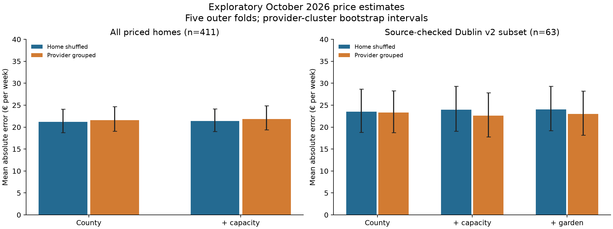

# Nursing home contract prices in Ireland

## Executive summary

This study examines the original question, “What drives nursing home contract prices?”, through reproducible comparisons of published weekly Fair Deal rates. Its operational question is whether location estimates rates accurately and whether registered capacity or a documented facility improves estimates for homes excluded from model training. The analysis describes a single price edition and tests incremental predictive information. It does not estimate causal effects or price changes over time.

Across 411 private and voluntary homes, the national median produced a mean absolute error of €49.47 per week. Separating Dublin from the rest of Ireland reduced error to €26.43. Using county medians with a fallback for sparse counties reduced error to €20.40. In a separate regression comparison using identical evaluation homes and folds, adding log registered capacity changed error from €21.17 to €21.36. The corresponding uncertainty interval included both a small improvement and a small deterioration. Keeping homes with the same recorded provider together during evaluation gave the same substantive conclusion.

A facility analysis was possible for 63 Dublin homes with usable garden evidence. Adding a documented-garden indicator did not show a supported improvement. Evidence checks prevented activities-room and salon tests from proceeding. The results support geographic context for published prices on ClearCare. The capacity and garden results remain bounded by their model specification, source timing and selected sample.

## Research purpose and scope

ClearCare helps families discover and compare nursing homes using public information. A price displayed without context gives little indication of whether it is typical for the area. A geographic benchmark can supply that context. Testing capacity and extracted facility information also assesses whether more complex data collection adds measurable information to that benchmark.

The research has three objectives. First, measure how estimation error changes as location becomes more specific. Second, test whether registered size adds information beyond county. Third, investigate whether a source-supported facility mention adds information within a matched subset. Provider grouping supplies a robustness check. Ownership effects, care-type effects and a comprehensive amenities model were not estimated.

The outcome is the maximum agreed weekly rate in the private and voluntary HSE list. Public-home cost-of-care figures have a different basis and were excluded from these models. A resident's assessed Fair Deal contribution follows the scheme's financial assessment, and extra service charges may apply. The HSE explains that the assessed contribution remains the same across approved homes. [1, 3]

NTPF identifies incurred costs, previous prices, local market prices and budget considerations in price negotiation. The study does not observe these negotiations or centre-level operating costs. A feature that helps estimate rates could therefore reflect several underlying influences. [2]

## Sources and study population

The outcome comes from HSE Section 40 list 231, printed 14 October 2026. The archived file was fetched on 26 October and carries a last-modified date of 23 October. The printed edition date identifies the study outcome. SHA-256 verification fixes the exact bytes used, including any difference between printed date and file metadata. [1, 5]

The HIQA register snapshot supplies maximum occupancy and registered-provider names. It was fetched and last modified on 26 October. All 411 price IDs matched exactly one register record with positive capacity. Capacity ranged from 18 to 190 registered places. The twelve-day difference is accepted for an explicitly exploratory cross-sectional comparison. Capacity at the exact price-list date remains unverified. [4, 5]

| Measure | Observed coverage |
|---|---|
| Priced private and voluntary homes | 411 distinct HIQA IDs |
| Dublin homes | 86 |
| Homes outside Dublin | 325 |
| Exact register matches with positive capacity | 411 |
| Distinct exact provider names | 328 |
| Homes sharing a provider name with another home | 106 |
| Largest exact provider group | 27 homes |
| Priced homes with local v2 extraction files | 84 |
| Eligible garden subset | 63 homes, all in Dublin |

There are 327 priced homes without local v2 extraction files and 21 further exclusions after garden evidence checks. The 63 retained homes represent 15.3% of the national price sample and 73.3% of Dublin's listed homes. These are local research-file coverage figures. They do not measure current website extraction coverage.

Reports for the retained subset have recorded inspection dates from 31 July 2025 to 6 July 2026 and publication dates from 22 October 2025 to 7 October 2026. Publication dates were taken from the saved report manifest. Extraction occurred after the price-list date. The analysis therefore retrospectively processes reports available before that date, while the capacity data have the separate timing limitation described above.

## Data preparation and feature definitions

Price rows were read from the archived PDF using its text coordinates. The script checks that IDs and amounts align vertically, carries county headings across page breaks and requires 411 unique IDs. Rates are whole euros per week. Each home has equal weight, so the analysis describes listed homes rather than residents or beds.

County is a categorical feature. Capacity is the natural logarithm of maximum occupancy, a prespecified transformation that allows a proportional increase in size to have a consistent model effect. The same functional form is used throughout. Provider names are used as exact strings for grouping. Different legal names can belong to the same broader organisation, so these groups are an incomplete measure of ownership dependence.

Three common facility categories were screened in the existing v2 outputs: garden, activities room and hairdressing or beauty salon. Evidence checks verify source PDF hashes, page bounds, normalised quotation matches and an explicit facility term. Garden is documented in 50 eligible homes and unmentioned in 13. An unmentioned garden is coded as an absence of documentation. Its physical absence is unknown.

The garden comparison excludes missing files and failed evidence checks. Activities-room quotations sometimes referred to schedules or general day rooms, while salon quotations sometimes described visiting services. Those features were withheld because their interpretation could not be supported consistently. The checks do not establish complete extraction recall or independent semantic accuracy. Conservative quote matching may also reject valid paraphrases. The feature analysis uses existing extraction outputs and document checks. Teammate-owned human labels were not used to validate this feature model. [5]

## Geographic benchmark methods

Each of the 411 homes was held out once. Its weekly rate was estimated from the other 410 homes using three rules: their national median, their median within the same Dublin or outside-Dublin group, and their median within the same county. The county rule required at least five other homes. Otherwise it used the broader regional median. The threshold was fixed before scoring.

County medians were available for 389 held-out homes. The remaining 22 used the outside-Dublin fallback, comprising Carlow 5, Laois 3, Leitrim 2, Longford 3, Monaghan 4 and Offaly 5. Every home is excluded from every median used to estimate its own rate.

Mean absolute error, abbreviated MAE, is the average absolute difference between the estimated and published weekly rate. Its unit is euros per week, and a lower value means more accurate estimates. Improvements compare paired errors for the same homes. The original geographic intervals use 10,000 resamples of these fixed paired differences with seed 20261117. They treat homes independently and condition on the fitted predictions.

## Capacity and facility modelling methods

Ridge regression provides the common model for the added-feature comparisons. It combines county indicators with a penalty that discourages unstable coefficients. The capacity model adds log capacity. The facility model adds the documented-garden indicator. On the Dublin-only sample, county is constant and the county model supplies a training-set mean.

Evaluation uses five outer folds. Every home receives a prediction from a model trained without that home. One evaluation shuffles homes with seed 20261118. A second keeps all homes with the same exact provider name together. Models within a sample and evaluation use identical homes and outer folds.

Three inner folds select the ridge penalty from 0.1, 1, 10 and 100 using MAE. Encoding and numeric standardisation are fitted only on training data at each stage. Provider grouping is also maintained in the inner folds of the grouped evaluation. An unseen county receives an all-zero county indicator vector. This design limits information from held-out homes entering model selection.

For the new regressions, uncertainty uses 5,000 paired resamples of provider groups with seed 20261118. A sampled group contributes all its homes, and errors remain equally weighted by home. Intervals condition on the saved predictions and folds. They exclude model-refitting uncertainty, unidentified ownership links and changes across time. Comparing the original median error directly with a regression error combines differences in method and training size. Feature effects are assessed only within the matched regression comparisons.

## Price results

Published weekly rates range from €1,200 to €1,508, with a median of €1,290. The unweighted mean is €1,415.85 in Dublin and €1,288.82 elsewhere. These figures describe this frozen edition. [1, 5]

| Geographic rule | Homes | MAE in euros per week |
|---|---:|---:|
| National median | 411 | 49.47 |
| Dublin or outside-Dublin median | 411 | 26.43 |
| County median with regional fallback | 411 | 20.40 |

Moving from national to regional medians reduced MAE by €23.04 per week. The paired home-level interval was €18.87 to €27.31. Moving from regional to county medians reduced MAE by a further €6.03, or 22.8%, with an interval of €4.18 to €7.94. Geography contains substantial information about differences within this price list.

| Capacity evaluation | County MAE | County plus capacity MAE | Improvement and 95% interval |
|---|---:|---:|---|
| Shuffled home folds, 411 homes | 21.17 | 21.36 | −0.19 (−0.78 to 0.41) |
| Provider groups, 411 homes | 21.56 | 21.82 | −0.26 (−0.87 to 0.35) |

All amounts in the table are euros per week. Positive improvement means lower error after adding capacity. Neither evaluation provides evidence of a clear improvement. This answers the incremental estimation question for this particular log-capacity ridge model. It does not establish that capacity has no association with price under other specifications.

| Garden subset evaluation | County MAE | Plus capacity MAE | Plus garden MAE |
|---|---:|---:|---:|
| Shuffled home folds, 63 homes | 23.51 | 23.94 | 24.01 |
| Provider groups, 63 homes | 23.29 | 22.62 | 22.99 |

For shuffled folds, adding garden increased MAE by €0.07. Expressed as improvement, the estimate was −€0.07, with an interval of −€0.47 to €0.31. With grouped providers, MAE increased by €0.36, giving an improvement estimate of −€0.36 and an interval of −€0.78 to €0.04. There is no supported incremental improvement. The selected Dublin subset and the distinction between documented and unmentioned facilities restrict generalisation.



Figure 1. Held-out regression errors for the national capacity comparison and the selected Dublin garden comparison. Error bars are provider-group bootstrap intervals for MAE. The paired improvement intervals in the text assess differences between models. They answer a different question from the intervals around individual MAEs.

## Interpretation and limitations

The most consistent result is the geographic benchmark. It supports describing where a listed rate sits among geographically similar homes. The extra variables tested showed no clear incremental improvement in the matched regression comparisons. A small or negative improvement is a substantive result because the comparison uses identical evaluation records and makes uncertainty explicit.

The wider original question remains only partly answered. Negotiated prices reflect unobserved costs, earlier contracts, care provision and market conditions. No adjusted coefficient analysis, causal design or longitudinal price analysis was completed. The capacity analysis tests one transformation and model family. There is no national result for amenities as a whole, and care types were not modelled.

The national list is a complete cohort for the selected edition, while generalisation to another edition remains uncertain. Near-dated capacity and provider information may differ from their historical values. Exact provider names can miss shared ownership. The facility subset is geographically concentrated and selected through extraction availability and evidence checks. Missing documentation can reflect report emphasis rather than a missing service. Bootstrap intervals omit some sources of uncertainty and should not be interpreted as guarantees of future performance.

## Implications for ClearCare

A proposed website extension would place each published rate beside a dated county peer median and middle 50% range, with a stated sample size and a broader regional fallback where appropriate. It should retain the official amount and source edition and explain the scheme's resident-contribution distinction. These are proposed applications of the findings. They were not implemented as part of this analysis.

The research page can explain the model comparisons and the limited added value observed for capacity and garden documentation. The evidence does not support pricing an individual facility, replacing an official missing rate with an unlabelled estimate, or ranking a home's value for money from these variables alone. Further research would need stronger facility validation, broader matched coverage and additional dated price editions.

## Reproducibility and verification

The study folder contains benchmark.py, exploratory.py, requirements.txt, held-out.csv, model-results.csv, model-predictions.csv, feature-audit.csv, evidence-checks.csv, input-hashes.csv and the figure. The bundled inputs.zip preserves all required source objects, extraction files and manifests. prepare_inputs.py verifies inputs.sha256 and every archive member before unpacking into inputs/. Both scripts use only this frozen bundle and run offline after dependency installation. Rerunning replaces derived outputs; modified retained inputs fail checksum verification.

The geographic benchmark was rerun successfully. All ten new model-result rows were checked against saved individual predictions, and comparator homes and fold assignments matched. Code review confirmed training-only preprocessing and nested tuning. These checks establish internal reproducibility of the calculations, with the source-quality limitations described above.

Run the following from the repository root using the study environment and its recorded requirements.

```powershell
cd Research/october-price-benchmark
python -m venv .venv
.venv/Scripts/python -m pip install -r requirements.txt
.venv/Scripts/python benchmark.py
.venv/Scripts/python exploratory.py
```

## Conclusion

County-level information provides an effective within-edition benchmark for published private and voluntary Fair Deal rates. Registered capacity and garden documentation supplied no clear incremental accuracy gain in the tested comparisons. The completed contribution is a reproducible assessment of what these available public features add, together with explicit limits on timing, coverage and interpretation. The strongest immediate application is transparent geographic price context on ClearCare.

## References and research materials

[1] Health Service Executive. Nursing Homes Support Scheme maximum agreed prices, Section 40 list 231, printed 14 October 2026. [Official source PDF](https://www.hse.ie/documents/3223/HSE_Section40_List_231_Published_List_14.10.2026.pdf).

[2] National Treatment Purchase Fund. Nursing Homes FAQs, including contract-price considerations. Consulted 19 November 2026. [Official guidance](https://www.ntpf.ie/information-for-nursing-homes/nursing-homes-faqs/).

[3] Health Service Executive. About the Fair Deal scheme. Consulted 19 November 2026. [Official scheme guidance](https://www.hse.ie/services/schemes-allowances/fair-deal-scheme/about/).

[4] Health Information and Quality Authority. Older persons register export. Study uses the archived 26 October 2026 snapshot. The live URL can change. [Register export](https://www.hiqa.ie/centre/export/older_persons_register.csv?_format=csv).

[5] ClearCare study materials. [Findings and methods](https://github.com/niwash/ClearCare/blob/main/Research/october-price-benchmark/findings.md), [original geographic benchmark](https://github.com/niwash/ClearCare/blob/main/Research/october-price-benchmark/README.md) and [research folder](https://github.com/niwash/ClearCare/blob/main/Research/october-price-benchmark). Exact HSE object hash 4815bafb52d02ca23c6572c62b9dca35056a47e38a04dbfa5501066ccec8e0f8. Register object hash 870ca9905d4ca22fc55adeeed3c1a5d6539ec445604ff88fa3c85bedc5ef53a2.
