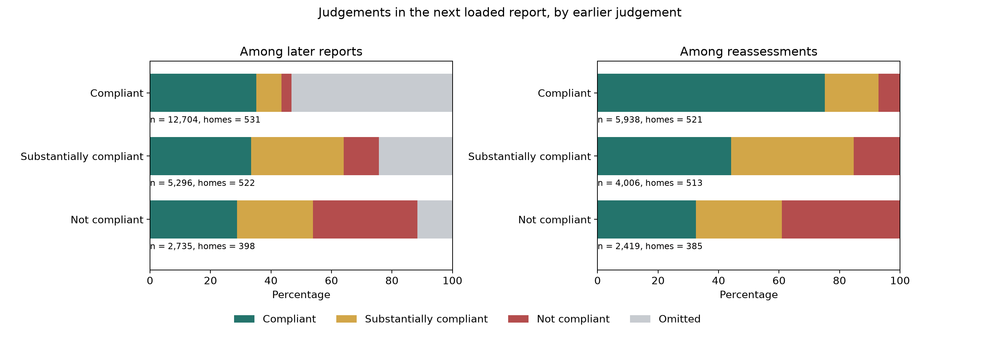
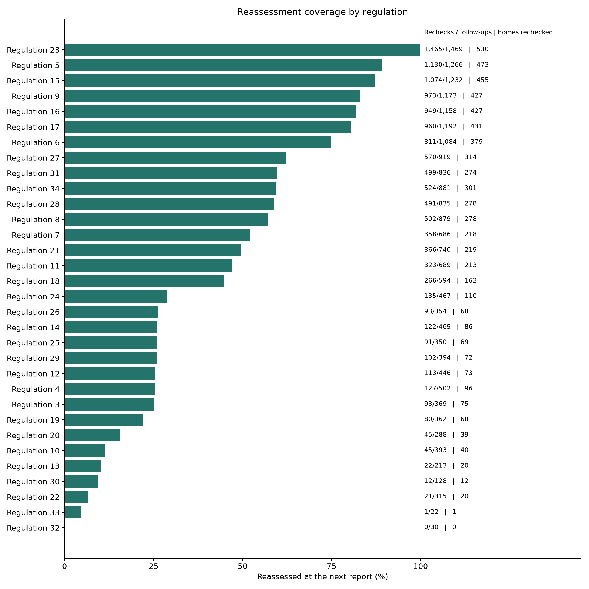

# Presentation findings, 18 November 2026

## What was measured

For each regulation judgement, identify the same home's next loaded dated report under ADR-0015. Record whether that report assessed the same regulation, then retain its printed judgement. The frozen export contains 2,019 reports from 535 homes, with inspection dates through 19 August 2026. The follow-up counts in these tables count earlier regulation judgements whose report has a next eligible report. A report pair can contribute several such observations. A reassessment is a regulation appearing in both reports. Each home can contribute multiple observations.

## Earlier judgement and next result

Counts below come from by-earlier-judgment.csv. Home columns count distinct centres at each stage and overlap between rows. The CSV files also provide separate distinct-centre counts for each of the three later judgement classes.

| Earlier judgement | Follow-ups | Homes with follow-up | Reassessed | Homes reassessed | Recheck % | Later C | Later SC | Later NC | Homes later NC | NC among reassessed |
|---|---:|---:|---:|---:|---:|---:|---:|---:|---:|---:|
| Compliant | 12704 | 531 | 5938 | 521 | 46.7% | 4464 | 1052 | 422 | 207 | 7.1% |
| Substantially compliant | 5296 | 522 | 4006 | 513 | 75.6% | 1768 | 1623 | 615 | 249 | 15.4% |
| Not compliant | 2735 | 398 | 2419 | 385 | 88.4% | 787 | 687 | 945 | 216 | 39.1% |

C means Compliant, SC means Substantially compliant and NC means Not compliant. These descriptive associations do not adjust for regulation, home or inspection selection.



## Regulation variation

denominators.csv reports all 32 regulation identifiers, later judgements and distinct homes. by-regulation-and-earlier-judgment.csv further splits these results by the earlier judgement. It retains omitted and no-later-report observations.



## Bounded additional source audit

Eight additional PDFs from four homes were selected deliberately, without random sampling. Claremount was selected for the duplicate-finding example identified by V4. TLC Carton supplies a focused two-regulation inspection and a broader report. Clonskeagh supplies a community nursing unit. Bishopscourt supplies reports from 2023 and 2026. These choices broaden report length, layout, date and home coverage. They do not establish representative coverage of all templates or thematic reports. Bishopscourt's sampled reports are not an adjacent pair.

All Appendix 1 rows were checked against first-occurrence exported judgements in both directions, including the continuation on Claremount page 24. PDF SHA-256 values matched the frozen API metadata. audit-evidence.json preserves the extracted page text and export entries. audit-results.csv records counts, page references and official URLs. These are single-reviewer source checks rather than teammate gold-set labels.

| Report | Home | Inspection date | Unique exported / printed | PDF pages | Issue |
|---|---|---|---:|---|---|
| 990 | 329 | 2024-03-04 | 18/19 | 23,24 | Registration Regulation 4 omitted. 17 duplicate compliance-plan entries in raw export. [Official PDF](https://www.hiqa.ie/system/files/inspectionreports/329-claremount-nursing-home-04-march-2024.pdf) |
| 989 | 329 | 2025-02-07 | 12/13 | 16 | Registration Regulation 7 omitted. [Official PDF](https://www.hiqa.ie/system/files/inspectionreports/329-claremount-nursing-home-07-february-2025.pdf) |
| 374 | 5800 | 2024-01-19 | 2/2 | 12 | All unique exported judgements matched. [Official PDF](https://www.hiqa.ie/system/files/inspectionreports/5800-tlc-carton-19-january-2024.pdf) |
| 373 | 5800 | 2024-02-15 | 15/16 | 21 | Registration Regulation 7 omitted. [Official PDF](https://www.hiqa.ie/system/files/inspectionreports/5800-tlc-carton-15-february-2024.pdf) |
| 102 | 491 | 2023-11-15 | 13/13 | 15 | All unique exported judgements matched. [Official PDF](https://www.hiqa.ie/system/files/inspectionreports/491-clonskeagh-community-nursing-unit-15-november-2023.pdf) |
| 101 | 491 | 2024-10-02 | 12/12 | 13 | All unique exported judgements matched. [Official PDF](https://www.hiqa.ie/system/files/inspectionreports/491-clonskeagh-community-nursing-unit-02-october-2024.pdf) |
| 434 | 200 | 2023-10-10 | 19/19 | 16 | All unique exported judgements matched. [Official PDF](https://www.hiqa.ie/system/files/inspectionreports/200-bishopscourt-residential-care-11-october-2023.pdf) |
| 430 | 200 | 2026-02-26 | 14/14 | 14 | All unique exported judgements matched. [Official PDF](https://www.hiqa.ie/system/files/inspectionreports/200-bishopscourt-nursing-home-limited-26-february-2026.pdf) |

The added sample matched all 105 unique exported judgements to printed findings, while 105 of 108 printed judgements were present in the export. Claremount's 35 raw entries reduce to 18 unique judgements using the view's first-entry rule. Registration Regulation 4 and Registration Regulation 7 remain separate legal identifiers from care-and-welfare Regulation 4 and Regulation 7.

Including the earlier Aclare and Marlay checks, coverage is 12 of 2,019 reports (0.59%) across six homes. All 155 unique exported judgements checked matched the source, while 155 of 159 printed entries appeared in the export. Four registration entries were missing. These selected observations cannot estimate national precision or recall. They show that the exported regulation population omits some legally distinct judgements.

## Slide-ready points

- We followed each regulation judgement to the home's next loaded eligible report. The national export supplied 20,735 follow-up observations, of which 12,363 were reassessed.
- Reassessment depended on the earlier judgement. Coverage was 46.7% after Compliant, 75.6% after Substantially compliant and 88.4% after Not compliant.
- Among reassessments, later Not compliant occurred in 7.1%, 15.4% and 39.1% of those earlier groups respectively. Regulation mix and selective inspection can contribute to these differences.
- The next report omitted 8,372 earlier regulations. Another 6,738 earlier observations had no later loaded report. Both groups have unobserved later judgements.
- The bounded source check covered 12 PDFs at six homes. All 155 unique exported judgements matched, with four additional printed registration judgements absent from the export.
- Available event counts support investigating a pooled prediction benchmark. Publication dates are absent from the saved schema, predictive performance is unmeasured, and chronology at the time of public availability cannot be verified from this export.

## Reproduction and remaining limitations

Run from the repository root in PowerShell.

```powershell
cd Research/solo-reassessment
python -m venv .venv
.venv/Scripts/python -m pip install -r requirements.txt
.venv/Scripts/python build.py
.venv/Scripts/python audit_sources.py
.venv/Scripts/python charts.py
```

The denominator build uses the standard library and the checksummed snapshot. PDF evidence extraction requires requests and PyMuPDF. Chart generation requires Matplotlib, installed as version 3.11.2 for this run. All twelve audit PDFs are preserved locally and hash-checked, so the audit script reuses those bytes. audit-results.csv records the reviewed findings.

The frozen inventory originated on 9 November and report details were retrieved on 17 November. Additional source checks were conducted on 18 November. Exact original response timestamps were unavailable. Unloaded reports, date ambiguities, corrected versions and incomplete registration coverage can affect the observation population. Official centre timelines were not exhaustively checked. The sample excludes thematic-template validation and independent second review. Distinct-centre counts quantify clustering but do not remove it. The exploratory 2026 outcome window does not establish a valid public forecasting evaluation without publication-time information.
